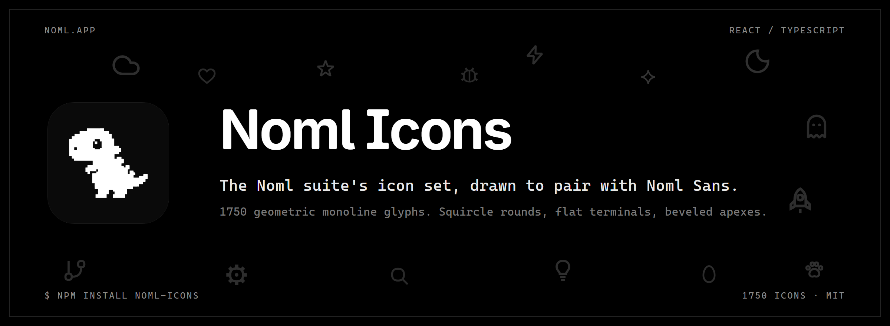
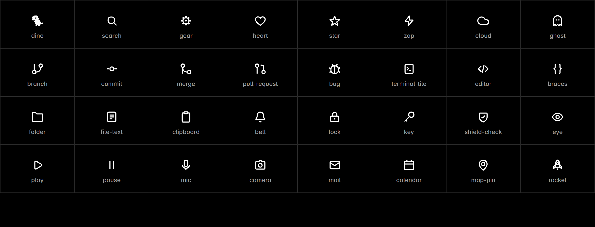

<p align="center">
  <a href="https://noml.app">
    
  </a>
</p>

<p align="center">
  <a href="https://www.npmjs.com/package/noml-icons"></a>
  <a href="https://noml.app"></a>
  
  
</p>

**Noml Icons** is the [Noml](https://noml.app) suite's icon set: 1750 geometric monoline glyphs drawn to pair with the Noml Sans typeface. Superellipse "squircle" rounds (exponent 2.55), flat butt terminals, beveled apexes. Every icon is a tree-shakeable React component on a 24-unit grid at stroke 2, inheriting `currentColor`.

---

## Install

```sh
npm install noml-icons
```

```sh
# or your package manager of choice
bun add noml-icons
pnpm add noml-icons
yarn add noml-icons
```

React 18+ is a peer dependency.

## Use

```tsx
import { PushIcon, SearchIcon, DinoIcon } from "noml-icons";

<PushIcon className="size-4 text-accent" />
```

Icons accept a single `className` prop and render a fixed 24x24 `viewBox` SVG. Size and color them with CSS (`width`/`height`/`color`, or Tailwind's `size-*` / `text-*`). They are decorative by default (`aria-hidden`); supply your own accessible labels on the surrounding control.

<p align="center">
  
</p>

The `squircle(cx, cy, r, k?)` path helper is also exported for drawing new glyphs in the same language: one cubic per quadrant, where `k = 0.7` matches the exponent-2.55 superellipse of the design DNA and `k = 0.85-0.92` gives the boxier corner used for large lone tiles.

## Browse the set

```sh
bun install
bun run demo   # writes docs/index.html
```

Open `docs/index.html` for a searchable gallery of every icon: size toggle (16/24/48), dark/light preview, click-to-copy imports.

## Design rules (for contributors)

- 24-grid, stroke 2, `currentColor`, `fill="none"` at the root; filled details are explicit `fill="currentColor"` paths (usually small squircle dots).
- Flat butt caps, never round. Apexes bevel (`strokeLinejoin="bevel"`), matching the font's chamfered apexes.
- Corners come from `squircle()` quadrants; box corners inline the same math (handle = 0.92·r).
- Legibility at 14px is the bar: short appendages need stroke 2.5-3 (thin detached ticks read as sun rays); arrowheads on arcs use axis-aligned corner brackets, with the arc sweeping into the bracket corner; rings are r=10 to match familiar optical sizes.
- Third-party brand glyphs (the "brands & social" section) are redrawn monoline to sit flush with the set, and stay as close to the official mark as the DNA allows.

## Build

```sh
bun run build   # tsc -> dist/ (ESM + d.ts)
```

## License

MIT, with two carve-outs:

- `SuiteIcon` and `DinoIcon` are the Noml suite's brand marks: the code is MIT like the rest, but please don't use the marks to represent your own product.
- The brand and social icons (GitHub, X, YouTube, and friends) are trademarks of their respective owners. They are included for the common "link to our socials" case; using them is subject to each owner's brand guidelines.
